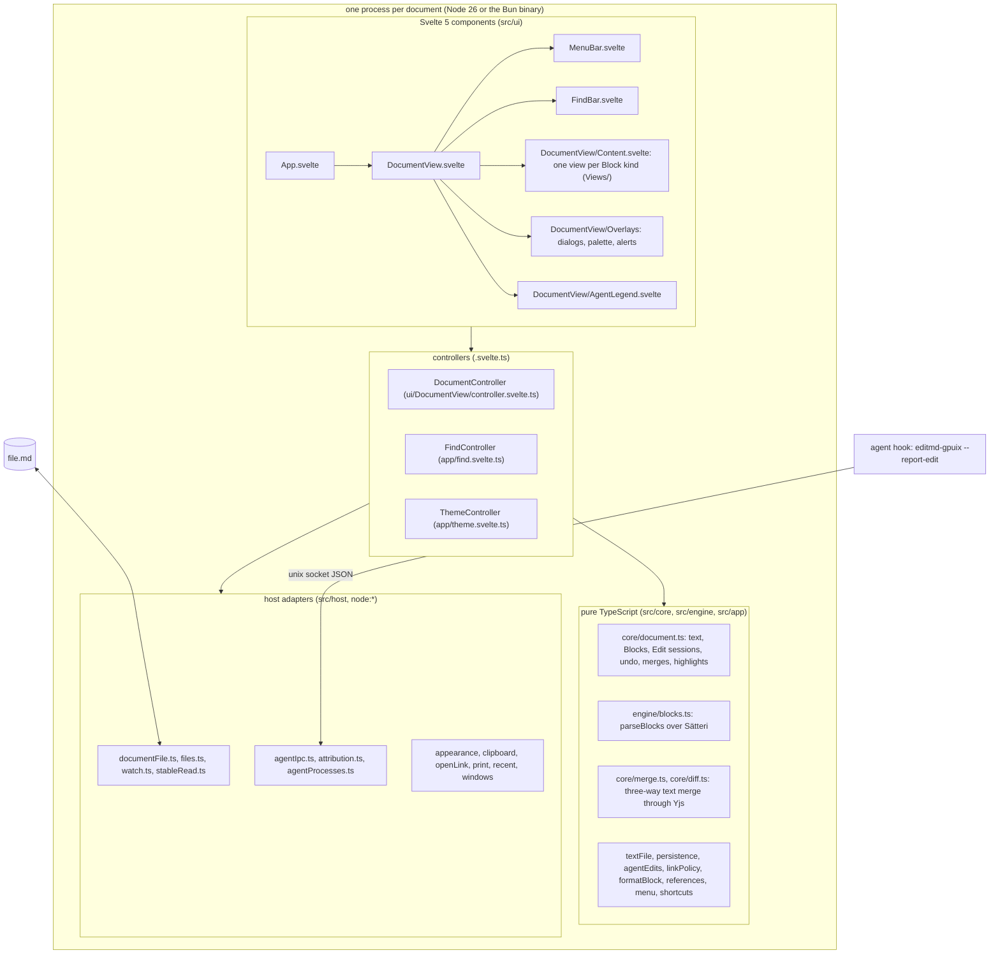
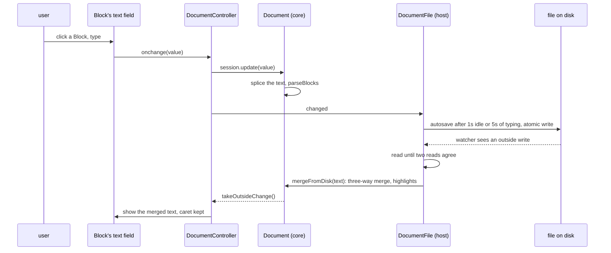
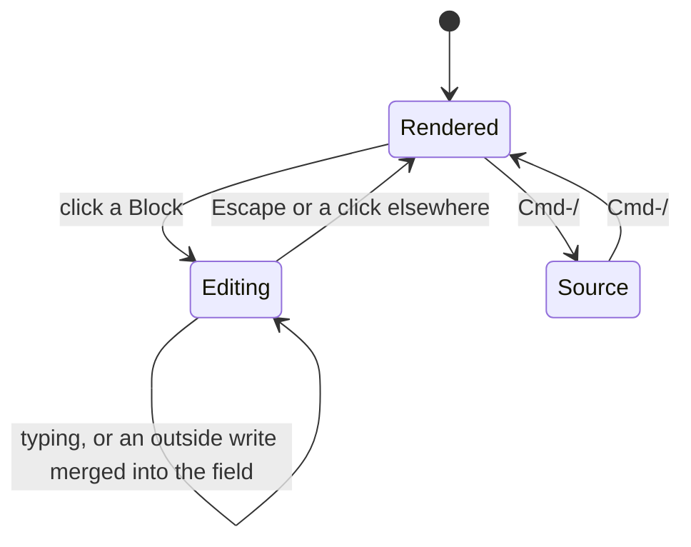

# Architecture

## Context

editmd-gpuix ports [kirahowe/editmd](https://github.com/kirahowe/editmd) (v0.2.0, MIT) to a native GPUI desktop app written in Svelte 5 on gpuix-svelte 0.2.0.

editmd is a Swift/AppKit `NSDocument` host around a WKWebView. The web view runs Milkdown 7.22.3 (ProseMirror), Yjs 13.6 with y-prosemirror 1.3.7, and Mermaid 11. gpuix renders Svelte into a native GPUI window. It has no DOM, no contenteditable, no inline styled text runs and no textarea selection API, so editmd's editor layer cannot be ported. The port edits one Block's markdown source at a time in a text field ([ADR-0003](adr/0003-block-click-to-edit.md)). editmd's pure logic (TypeScript and the Swift core) is ported with its property tests.

[parity.md](parity.md) compares every user-facing feature with editmd and names each gap (G1 to G17). Decisions are recorded in [adr/](adr/README.md).

## Components

Each document runs in its own process, because gpuix-svelte opens one window per process ([ADR-0008](adr/0008-windows-and-ipc.md)).



Rendering:

- Native `<markdown source>` is the only gpuix element that paints mixed inline runs, so each top-level Block is painted by its own `<markdown>`. Reference definitions are appended to each slice as context, so reference links resolve; painted per Block, 497 of editmd's 498 corpus cases paint the same text as the whole document in one element ([ADR-0005](adr/0005-rendering-native-markdown-per-block.md)).
- `<markdown>` paints `[^1]` literally outside table cells, so the port rewrites each footnote reference into a `footnote:` link run, and footnote definitions get their own view.
- pele's SVG uses CSS custom properties, which GPUI's `` decoder ignores. `core/mermaid.ts` resolves every variable to a literal colour before the SVG is shown ([ADR-0006](adr/0006-mermaid-via-pele.md)).
- The engine reparses the whole text after each change. A Sätteri parse of a 100KB document takes 2.509ms (median), of a 1MB document 35.678ms ([ADR-0002](adr/0002-markdown-engine-satteri.md)).

## Edit, save and merge



## Block editing states



A programmatic value moves a text field's caret to its end and clears its undo. When an outside write is merged into the open field, the controller puts the caret back where the typing ended by sending the field arrow keys (`caretKeys` in `core/fieldSelection.ts`).

## Module map

```text
editmd-gpuix/
  app.ts (render_hot)  standalone.ts (render, the binary's entry)  build.ts (Bun compile, .app)  test.ts (headless UI suite)
  docs/            architecture.md  parity.md  adr/
  src/core/        document model, merge, diff, text files, autosave machine, agent reports, links, images, Format commands
  src/engine/      blocks.ts (Blocks from Sätteri's mdast, UTF-16 offsets)
  src/host/        files, watching, agent sockets and attribution, appearance, clipboard, print, recent files, windows
  src/app/         launch and CLI modes, menus, shortcuts, palette and theme, find, zoom, snapshot and selftest
  src/ui/          DocumentView.svelte, MenuBar, FindBar; DocumentView/{Content, Views/, Overlays/, AgentLegend, controller}
  e2e/             real-window suites (gpuix-svelte/automation)
  scripts/         make-icon.swift (the app icon, from editmd's)
  test/fixtures/   editmd/: editmd's test corpus and sample.md; parity/: the inputs the parity checks paint
```
