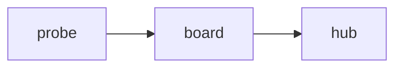

# Heading one

Some *emphasis*, **strong**, ~~strike~~, `inline code`, and a [link](https://example.com "Title").
A soft wrapped line continues here, with a [reference link][docs] and a footnote[^1].

## Heading two

### Heading three

#### Heading four

##### Heading five

###### Heading six

- star bullet
- another
  - nested

1. one
2. two

- [ ] todo
- [x] done

> A quote
> over two lines

```js
const x = 1 < 2;
```

| Plant | Moisture |
| :---- | -------: |
| Basil | 41%      |
| Mint  | 63%      |

---


[](https://example.com/ci) and an empty link [](https://example.com/empty).

Text with <span>inline html</span> in it.

<div align="center">block html</div>




[docs]: https://example.com/docs "Docs"

[^1]: The note.
